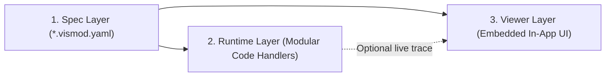

# VisMod Architecture

VisMod separates **what the decision logic is** from **how individual steps are implemented** and **how humans inspect it**.

## Three-Layer Design

### 1. Spec Layer (`*.vismod.yaml`)
- Declarative YAML files checked directly into your application repository.
- Validated against `spec/schema/vismod.v1.schema.json`.
- Easy for both humans and AI coding agents to read, diff in pull requests, and reason about deterministically.

### 2. Runtime Layer (Modular Code Contract)
- Every `action`, `decision`, or `end` step references a named `handler` implemented in your application's native language (TypeScript, Python, etc.).
- Forces code to be decomposed into small, single-responsibility, testable functions instead of monolithic nested conditionals.
- Implementations pass the shared test suite in `spec/conformance/` so a `*.vismod.yaml` file behaves identically across languages.

### 3. Embedded In-App Viewer Layer
- Ships as a lightweight UI component (e.g., React, web component, or server-rendered panel) embedded directly inside your application.
- Respects each flow's `visibility` setting (`public`, `admin`, `internal`) so teams can expose decision logic to all users for transparency or restrict it to admins/developers for auditing.

---

## Future Evolution

### Online Visual Editor (Phase 2)
Authorized users will be able to edit flows visually inside the app and export/commit updated `*.vismod.yaml` files back to version control.

### System Dependencies (Phase 3)
The same declarative YAML + embedded visual graph model will extend from function-level decision flows to **system-level dependency graphs** (modules, services, queues, and external APIs).

---

## Open Design Questions

- **Execution model:** Runtime interpreter vs. optional build-time typed code generation from `*.vismod.yaml` (implementations may support either or both as long as they satisfy `spec/conformance/`).
- **Live execution tracing:** Standardizing an optional trace event payload so the embedded viewer can highlight the exact path taken for a given request or session.
